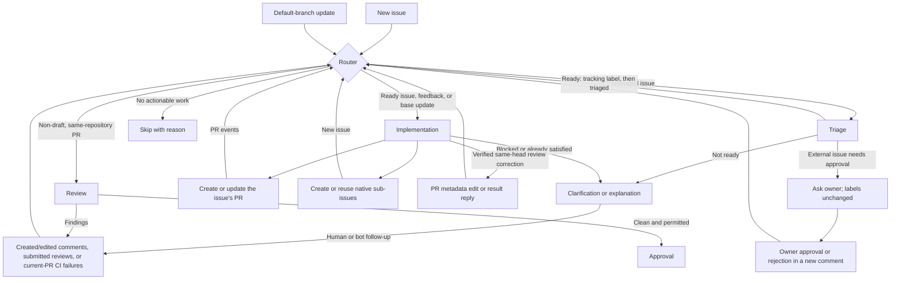
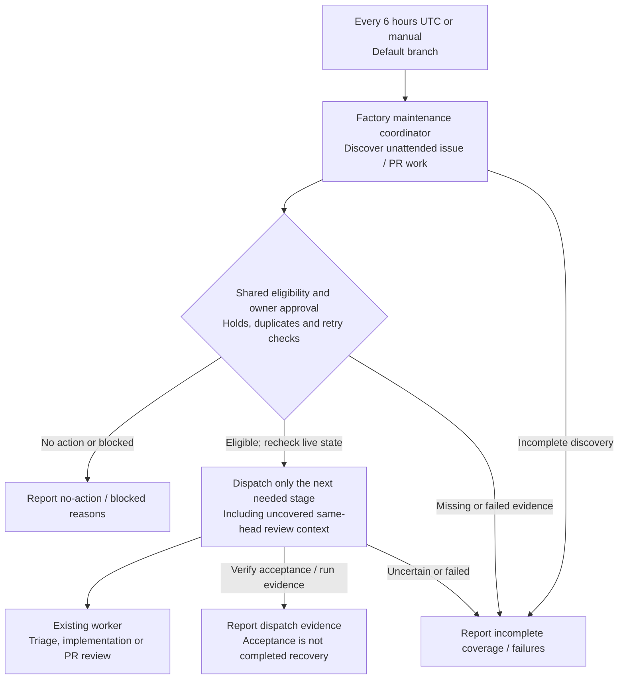
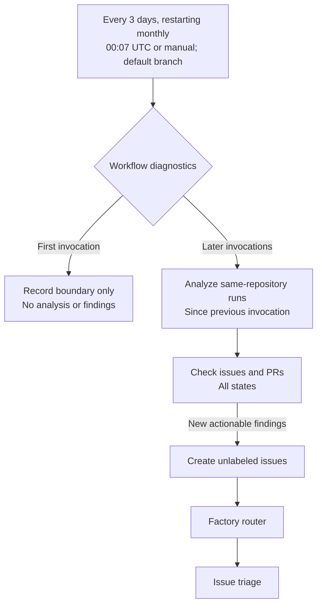
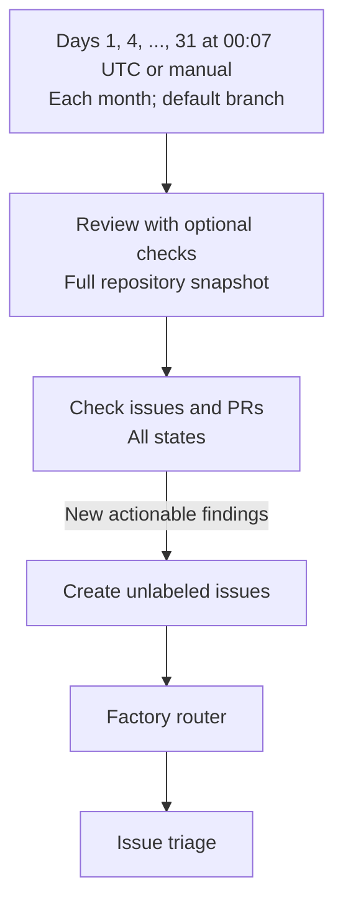
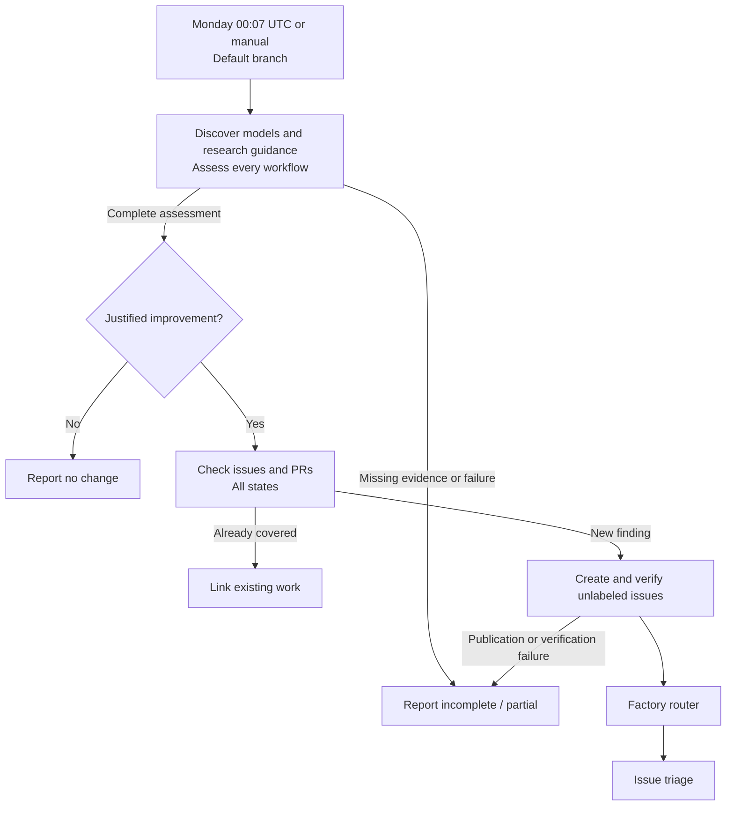
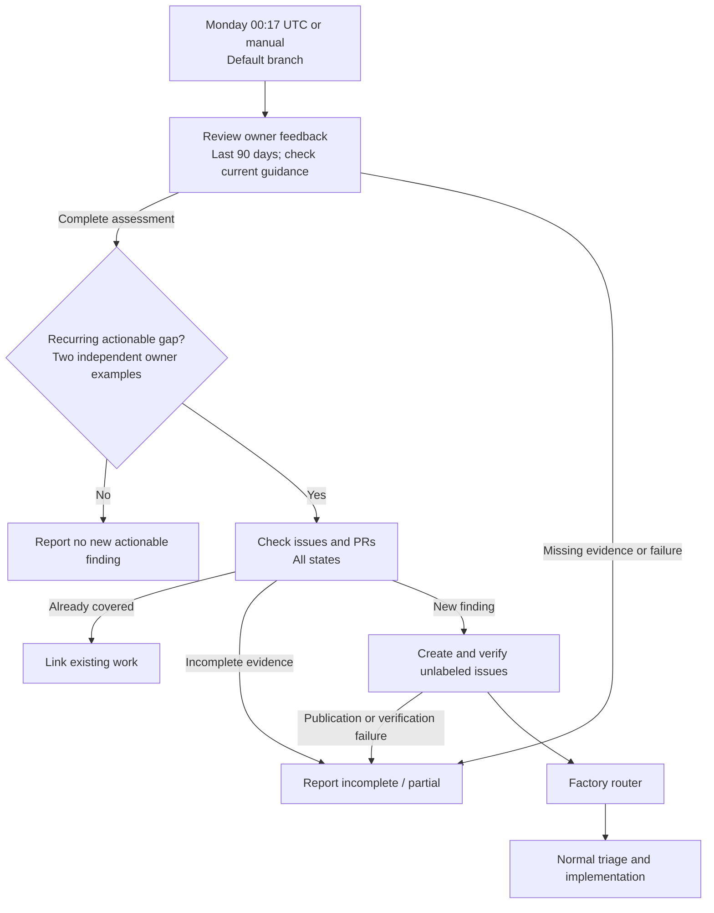

# Factory

An agentic software factory experiment, starting with small CI milestones:

- [x] Run GitHub Copilot CLI in CI
- [x] Read and write repository content, issues, and PRs from CI
- [x] Review PRs and post comments or approvals
- [x] Turn issues and follow-up comments into PRs or Factory replies
- [x] Check shell syntax, model JSON, and [launcher contracts offline](docs/examples/ai-tools.md#offline-checks)

## Factory workflow

The [router](docs/factory/factory-router.md) sends events to Copilot workers for
triage, implementation, or review. Workers check current state and verify results.

Assignments carry an explicit target repository, defaulting to this Factory host
for existing callers. **External targets are disabled.** Factory tooling and
policies stay at the executing workflow revision in a separate checkout from
editable target code and project guidance. APIs, receipts, ownership, concurrency,
and reports use the [host/target contract](docs/factory/target-context.md).

People and other bots provide input under their own accounts. The router runs as
`github-actions[bot]`; Factory work uses `factory-worker-bot[bot]`, and reviews use
`factory-reviewer-bot[bot]`.

The owner's requests and verified configured automation proceed normally;
requests from other humans/bots need scoped
[repository-owner approval](docs/factory/participant-approval.md). AI may request
approval before normal triage; approval neither marks an issue ready nor adopts
unrelated feedback. This is an AI-owned hold, not a pre-Copilot gate or spending limit.

Each shared AI action call sets its own [invocation budget](docs/examples/ai-tools.md#invocation-budget).
Copilot and its subtasks share that deadline; setup and receipt checks run
outside it, under GitHub's default job limit.

Factory opts Copilot invocations into native
[Copilot Memory](docs/factory/copilot-memory.md) for useful repository facts,
including earlier decisions and reviewed helper locations. Memory is optional,
never replaces live checks, and still needs storage/recall verification with
Factory's workflow authentication.

PR reviewers may run PR code, tests, and focused experiments under the
[PR-review execution rules](docs/factory/pr-review.md#local-checks).

Implementation keeps eligible PRs current with the default branch and resolves
conflicts, but never merges PRs or closes issues. It self-reviews changed candidates
with the `review` profile before publication, except for clean default-branch-only
maintenance.
Independent PR review still runs. Verified clean base-merge heads can reuse prior
coverage for a [scoped reassessment](docs/factory/pr-review.md#clean-default-branch-merges),
with a fresh review of the new head.
Review-relevant PR metadata edits and Factory PR replies also reach the router:
verified corrections or already-addressed findings can need
[fresh review at the same head](docs/factory/pr-review.md#review-coverage).
Cosmetic edits and already-covered or equivalent active work cause no redispatch;
only the independent reviewer decides approval.
See [implementation guidance](docs/factory/issue-implementation.md) for eligibility,
parent/child ownership, split recovery, and verification.

**Before-merge risk:** eligible submitted reviews run the PR-merge-revision router.
Router/setup changes can therefore execute before merge with the router's token.
Other events and workers use the default branch. See the
[accepted risk](docs/factory/factory-router.md#accepted-risk-router-changes-can-run-before-merge).
PR checks also run in a credentialed reviewer job, with the
[accepted risk of approval-token access or receipt-check bypass](docs/factory/pr-review.md#accepted-risk-pr-code-runs-in-the-reviewer-job).
Removing environment variables does not isolate credentials.

## Periodic recovery

[Factory maintenance](docs/factory/factory-maintenance.md) runs every six hours at
00:00, 06:00, 12:00, and 18:00 UTC, or manually on the default branch. It discovers
missed or interrupted triage handoffs, implementation, reviews, feedback, and default-branch updates,
then dispatches the existing workers using the router's
[shared policy](docs/factory/routing-policy.md).

The coordinator uses the built-in token for read-only discovery and workflow
dispatch, not comments, labels, code changes, or new issues/PRs. It reconciles
active/handled work across sweeps and ordinary routing, respects human/approval
holds and child-owned scope, and reports coverage, dispatch evidence, and partial
failures in the job summary. Dispatch acceptance is not completed recovery.

## Workflow diagnostics

[Workflow diagnostics](docs/factory/workflow-diagnostics.md) uses parallel read-only
native subagents to compare same-repository runs and GitHub outcomes against each
run's contracts, including successful runs and expected skips or handoffs.
Diagnostics also assesses time-budget utilization and recommends evidence-backed
timeout changes through the existing findings path.

## Repository review

[Repository review](docs/factory/repository-review.md) reads the whole source
snapshot from scratch and may run focused checks or experiments without changing
the reviewed source.

Both workflows publish only new actionable findings as unlabeled Factory issues
for triage and report supported conclusions and coverage gaps in the job summary.

## Model profile improvement

[Model profile improvement](docs/factory/model-profile-improvement.md) discovers
models available to Copilot, researches current provider guidance, and assesses
every Factory workflow individually, prioritizing **intelligence > speed > cost**.

Recommendations become **new untriaged Factory issues**, not direct PRs or
profile edits. Findings and the run summary record capability checks,
per-workflow decisions, and dated evidence.

## Owner feedback learning

[Owner feedback learning](docs/factory/owner-feedback.md) runs weekly on
**Monday at 00:17 UTC** or manually on the default branch. It reviews the last
**90 days** of the owner's issue/PR discussions and reviews, including inline
feedback on older or closed work, for recurring preferences that current
instructions, docs, or prompts do not yet address.

Findings need multiple independent owner examples, current-guidance checks, and
provider research where applicable. The evaluator reconciles issues and PRs in
all states, then creates only new **unlabeled Factory issues** for normal triage
and implementation. It does not directly edit guidance or existing discussions.
No new actionable pattern means no new issue; incomplete coverage and failures
are reported explicitly in the job summary and retained log.

## CI examples

These are reusable snippets, not installed workflows. Basic examples use the
built-in token and need no PAT or custom secret. Factory uses
[GitHub Apps](docs/factory/github-app.md) for downstream events and separate
author/reviewer identities.

1. [Install Copilot and run a prompt](docs/examples/ai-tools.md)
2. [Create a pull request](docs/examples/create-pull-request.md) - tested successfully.
3. [Create an issue](docs/examples/create-issue.md) - tested successfully.

## Factory guidance

Worker contracts and verification boundaries live in [docs/factory/](docs/factory/).
Start with [participant approval](docs/factory/participant-approval.md),
[routing](docs/factory/factory-router.md), [triage](docs/factory/issue-triage.md),
[implementation](docs/factory/issue-implementation.md), or [PR review](docs/factory/pr-review.md).
Contributor expectations are in [AGENTS.md](AGENTS.md).
